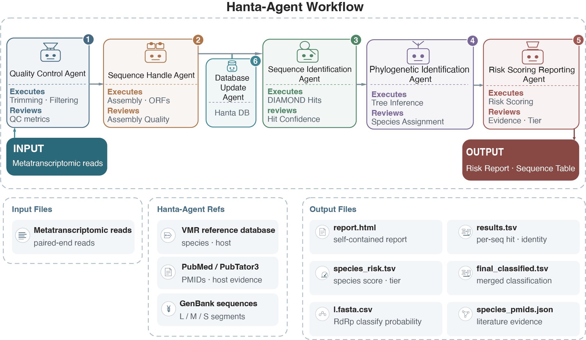

# Hanta-Agent

[English](README.md) | [中文](README_zh.md)

A six-agent pipeline for hantavirus analysis: from raw metatranscriptomic reads to a classified, risk-tiered sequence table and a readable report.



## Quick start

```bash
git clone https://github.com/Yu-Lab-Genomics/Hanta-Agent.git && cd Hanta-Agent
git clone https://github.com/alibaba/LucaProt.git scripts/LucaProt   # 870 MB, needed by step 4

conda env create -f env/lpy-hanta-v2.yml    # main pipeline
conda env create -f env/lucaprot.yml        # only for the optional LucaProt step
cp skills/config.example.yaml skills/config.yaml   # then set project_dir, data_dir, results_dir
```

That is all the setup. Then open the repository in an AI editor and say:

> Use hanta-agent to analyse the paired-end sample SRR24112974 under `data/`. Run
> each step with `--dry-run` first and show me the command before executing. Stop
> and ask if any step fails.

The agent reads `skills/<agent>/SKILL.md` for every stage and runs them in order.
There is no database download step: `DB/` ships with the repository, and the one
large piece — a 1.2 GB rRNA index — is fetched automatically by step 1 the first
time it runs.

Details for each stage are in the sections below.

## 1. What this is

Five agents run in sequence, each reviewing whether the previous step's output can be trusted. `Database Update Agent` sits alongside and supplies the reference database.

Three differences from a conventional metagenomic virus workflow:

1. **Species assignment comes from a tree, not from the best hit alone.** DIAMOND produces candidates and the tree confirms placement. A contig is called at species level only when it falls inside that species' monophyletic clade with adequate branch support; otherwise it stays at genus level.
2. **LucaProt is added as an independent signal.** This deep-learning model predicts RdRp probability, uncorrelated with both the DIAMOND score and the tree support, giving a third component of detection confidence.
3. **The output is a risk tier.** Host, phylogeny, literature traits and human-infection evidence combine into a species risk score, multiplied by detection confidence to give a per-sequence final score and a high / medium / low tier.

| # | Agent | Responsibility | In → Out |
|---|---|---|---|
| 1 | Quality Control | Trimming, adapter removal, low-complexity filtering, rRNA depletion | Paired FASTQ → clean reads |
| 2 | Sequence Handle | De novo assembly, ORF prediction, DIAMOND alignment | Clean reads → per-segment hit tables |
| 3 | Sequence Identification | Merge hits from three databases, dereplicate, attach reference metadata | Hit tables → classified table |
| 4 | Phylogenetic Identification | Build a shared tree, assign species, LucaProt probability | Classified table → table with tree columns + L proteins |
| 5 | Risk Scoring Reporting | Score, tier, render the report | Above products → scores + HTML report |
| 6 | Database Update | Build or refresh the reference database | Manifest + dereplicated nucleotides → DIAMOND indexes + tree backbone |

Parameters, output formats and troubleshooting live in each agent's `SKILL.md` and `references/`.

## 2. Getting the repository

```bash
git clone https://github.com/Yu-Lab-Genomics/Hanta-Agent.git
cd Hanta-Agent

# external dependency, about 870 MB (including 95 MB of model weights)
git clone https://github.com/alibaba/LucaProt.git scripts/LucaProt
```

Placing LucaProt at that fixed location means step 4 needs no path configuration. `scripts/LucaProt/` is already listed in `.gitignore` — **confirm the ignore rule is active before cloning**, otherwise `git add .` will try to commit 870 MB.

```
Hanta-Agent/
├── skills/              six agents (each with SKILL.md + scripts/ + references/),
├── config.example.yaml                      plus config.example.yaml
├── scripts/LucaProt/    external tool (cloned, not tracked)
├── env/                 two conda environment definitions
├── DB/                  reference database: 25.7 MB shipped, 1.2 GB rRNA index from a release
└── figure/              README images
```

`config.yaml` is not in the listing because it is gitignored: copy the template as shown in 3.2.

The root `scripts/` holds external tool code only; pipeline scripts live under `skills/<agent>/scripts/`.

## 3. Environment setup

### 3.1 Two conda environments

```bash
conda env create -f env/lpy-hanta-v2.yml    # main pipeline
conda env create -f env/lucaprot.yml        # LucaProt inference (different PyTorch version)
```

### 3.2 Configuration file

`config.yaml` is gitignored because it holds absolute paths for one machine. Start from the template:

```bash
cp skills/config.example.yaml skills/config.yaml
```

Then edit `skills/config.yaml` and change three values:

```yaml
project_dir: /path/to/Hanta-Agent        # DB/ inside this directory holds the database

paths:
  data_dir:    /path/to/your/fastq       # directory holding the paired-end reads
  results_dir: /path/to/your/results     # where results are written
```

`project_dir` is used for one thing only: locating `<project_dir>/DB`. Get it wrong and none of the six agents can find the reference library.

### 3.3 Reference database

`DB/` comes with the repository and holds everything except the rRNA index: the manifest, the DIAMOND indexes, the curated library and the tree backbone, 25.7 MB in total. Those need no setup.

The rRNA index is six bowtie2 files totalling about 1.2 GB, published as a release archive. **You do not have to fetch it yourself.** The first run of agent 1 checks for the index and downloads it before processing any sample, so cloning and running step 4 below is enough.

If the compute nodes have no internet access, prefetch it once on a machine that
does — the command is in [`DB/README.md`](DB/README.md), section 3. Either way the
index arrives as one archive, is extracted into `DB/sortmerna/`, and the archive is
deleted again. Set `bowtie2.auto_fetch: false` in the configuration to turn the
automatic download off.

Full layout, per-file consumers and rebuild instructions: [`DB/README.md`](DB/README.md).

## 4. Writing prompts

These skills are driven by an AI agent — state the intent and the agent reads each `SKILL.md`, so there is no need to memorise commands.

**Run the whole pipeline**

```
Analyse every paired-end sample under data/ with hanta-agent,
using skills/config.yaml.

Run each step with --dry-run first and show me the command before executing.
```

**Run a single step**

```
Run quality-control-agent on the one sample SRR24112974.
Show me the dry run first.
```

**Resume from the middle**

```
QC is already done. Continue with sequence-handle-agent.

If the previous step's outputs are incomplete, tell me which file is missing.
Do not guess and do not skip ahead.
```

Constraints worth stating explicitly:

| Constraint | Why |
|---|---|
| `--dry-run` before every real run | Assembly and tree building take hours; reviewing the command first avoids wasted runs |
| On failure, read `results/json/<sample>.*.json` first | Every script records the cause in a `message` field — more reliable than guessing |
| Do not add a pident cutoff to filter sequences | The reference library is hantavirus-specific, so any hit means a related sequence. Low identity means the contig covers a fragment, not that the detection is doubtful |
| Use absolute paths throughout | On shared servers `cd X && command` sometimes fails, and relative paths then resolve to the wrong place |
| Do not skip steps | Each step consumes the previous step's JSON output; skipping produces silent errors |

For **whether to overwrite existing results**, **whether to drop to genus level or adjust the threshold when tree support falls short**, and **whether to skip or repair LucaProt when its environment is unavailable**, ask the agent to stop and check with you rather than deciding on its own.

## 5. Where to find the results

Everything is under `results_dir/00_results/`:

| File | What to look at |
|---|---|
| `report.html` | Open in a browser. A self-contained single file you can send to collaborators; best for a quick overview |
| `results.tsv` | One row per sequence. Key columns: `species`, `detection_confidence`, `species_risk_score`, `final_score`, `tier` |
| `species_risk.tsv` | One row per species. Shows how the risk score was assembled: host, phylogeny, literature traits, human-infection evidence |
| `all_vmr_final_classified.tsv` | The merged master table with every tree column and classification result. Use this for secondary analysis |
| `l.fasta.csv` | LucaProt RdRp probability. `prob` runs 0–1; a value near 0.5 means the model has no strong opinion |

Three points that are easy to misread:

- `final_score = detection_confidence × species_risk_score` — the two factors are independent: how certain the detection is, times how serious the species is.
- `tier` splits at 60 and 30: `≥60` high, `≥30` medium, otherwise low.
- A species with documented human infection is floored at `max(species risk, 60)` and tiered high, without discounting for detection confidence; a `human_evidence` entry in the `flags` column means that rule fired. This is deliberate — a fragment of a known human pathogen still deserves attention.

Intermediates, needed only for troubleshooting, live in `json/`, `log/`, `06_diamond_vmr/` and `07_tree/`.

## 6. Minimal working example

Run one sample end to end first, then scale up. Every step below is something you
say to the AI agent; it reads the matching `SKILL.md` and decides what to run.

**Prerequisite:** one paired-end sample under `data/`, for example
`SRR24112974_R1.fq.gz` and `SRR24112974_R2.fq.gz`. Nothing to prepare for the
database — `DB/` ships with the repository, and step 1 downloads the 1.2 GB rRNA
index on first use.

| Step | Say this | What you get |
|---|---|---|
| 1 | "Run quality control on SRR24112974 — dry run first." | `results/04_megahit/SRR24112974/final.contigs.fa`, `results/json/SRR24112974.qc.json` |
| 2 | "QC looks fine. Continue with assembly and alignment." | `results/06_diamond_vmr/SRR24112974.vmr_{l,m,s}.tsv` |
| 3 | "Merge and dereplicate the hits." | `results/06_diamond_vmr/SRR24112974.vmr_final_classified.tsv` |
| 4 | "Build the tree and assign species." | `results/07_tree/_all/`, `results/00_results/all_vmr_final_classified.tsv` |
| 4b | "Run LucaProt on the L proteins." — optional, needs the GPU environment | `results/00_results/l.fasta.csv` |
| 5 | "Score the sequences and render the report." | `results/00_results/{results.tsv, species_risk.tsv, report.html}` |

Only move to the next step once the previous output looks right. If a step fails,
the agent should read `results/json/<sample>.*.json` and report `failed_step` and
`message` rather than guessing.

Once `report.html` looks right and the numbers make sense, do the same for every
sample — say "run every sample under `data/`" rather than naming one.

**Step 4 builds one tree shared by all samples.** In batch mode, finish steps 1–3
for every sample first, then run step 4 once. A separate tree per sample makes
branch lengths incomparable.

## 7. Citation

Manuscript in preparation. Until it appears, work that uses this pipeline should also cite the LucaProt paper:

```bibtex
@article{LucaProt2024,
  title   = {Using artificial intelligence to document the hidden RNA virosphere},
  journal = {Cell},
  year    = {2024},
  doi     = {10.1016/j.cell.2024.09.027}
}
```

## 8. Licence

Copyright 2026 Yu-Lab-Genomics

This repository is released under the [Apache License 2.0](LICENSE); the full text is in `LICENSE`. Three categories of third-party material fall outside that licence:

| Content | Owner | Note |
|---|---|---|
| Reference sequences | NCBI Nucleotide | Public domain. What this repository distributes is the cleaned, dereplicated assembly of them |
| Species metadata | ICTV VMR | Subject to the ICTV terms of use |
| LucaProt model and code | Alibaba, Apache 2.0 | Cloned by the user into `scripts/LucaProt`; no LucaProt code is included here |

Research use must also comply with the terms of each source above. The software is provided under the "AS IS" terms of Apache 2.0, without warranty of any kind.
