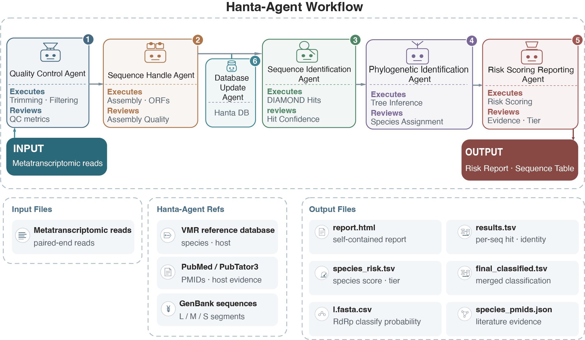

# Hanta-Agent

[English](README.md) | 中文

由六个 AI agent 接力组成的汉坦病毒分析流程：从宏转录组原始测序数据出发，输出带物种鉴定和风险分级的序列表与可读报告。



## 1. 这是什么

图中五个 agent 依次执行，每一步都复核上一步产物是否可信；`Database Update Agent` 在旁提供参考数据库。

与常规宏病毒组流程的三点区别：

1. **用树定种，不只看最佳 hit。** DIAMOND 出候选，建树确认位置；落在某物种单系支内且分支支持度达标才判种，否则留属级。
2. **LucaProt 作为独立信号。** 深度学习预测 RdRp 概率，与 DIAMOND、树支持度互不相关，作为第三个检出可信度分量。
3. **输出风险分级。** 宿主、系统发育、文献性状、人类感染证据合成物种风险分，乘检出可信度得到每条序列的最终分与高中低三档。

| # | Agent | 职责 | 输入 → 输出 |
|---|---|---|---|
| 1 | Quality Control | 质控、去接头、低复杂度过滤、去 rRNA | 双端 FASTQ → 干净 reads |
| 2 | Sequence Handle | 从头组装、ORF 预测、DIAMOND 比对 | 干净 reads → 每段命中表 |
| 3 | Sequence Identification | 合并三库命中、去冗余、挂参考元数据 | 命中表 → 分类表 |
| 4 | Phylogenetic Identification | 建共享树、定种、LucaProt 概率 | 分类表 → 带树列的分类表 + L 蛋白 |
| 5 | Risk Scoring Reporting | 打分、分级、生成报告 | 上述产物 → 分数 + HTML 报告 |
| 6 | Database Update | 构建 / 更新参考数据库 | 清洗后核酸库 → DIAMOND 库 + 树骨架 |

参数、输出格式、排错手册见各 agent 的 `SKILL.md` 与 `references/`。

## 2. 获取仓库

```bash
git clone https://github.com/Yu-Lab-Genomics/Hanta-Agent.git
cd Hanta-Agent

# 外部依赖，约 870 MB（含 95 MB 模型权重）
git clone https://github.com/alibaba/LucaProt.git scripts/LucaProt
```

LucaProt 放在这个固定位置后，第 4 步无需任何路径配置。`scripts/LucaProt/` 已在 `.gitignore` 里，**clone 前先确认忽略规则生效**，否则 `git add .` 会试图提交 870 MB。

```
Hanta-Agent/
├── skills/              六个 agent（各自含 SKILL.md + scripts/ + references/）+ config.yaml
├── scripts/LucaProt/    外部工具（clone 进来，不进 git）
├── env/                 两个 conda 环境定义
├── DB/                  参考数据库
└── figure/              README 用图
```

根目录 `scripts/` 只放外部工具代码，流程脚本在 `skills/<agent>/scripts/`。

## 3. 必备环境安装

### 3.1 两个 conda 环境

```bash
conda env create -f env/lpy-hanta-v2.yml    # 主流程
conda env create -f env/lucaprot.yml        # LucaProt 推理（PyTorch 版本不同）
```

### 3.2 配置文件

编辑 `skills/config.yaml`，改三处：

```yaml
project_dir: /path/to/Hanta-Agent        # 数据库在这个目录下的 DB/

paths:
  data_dir:    /path/to/your/fastq       # 双端测序文件所在目录
  results_dir: /path/to/your/results     # 结果输出目录
```

`project_dir` 只用于定位 `<project_dir>/DB`，填错则六个 agent 都读不到库。

## 4. prompt 怎么写

这些 skill 给 AI agent 用，把意图说清楚即可，不必记命令。

**跑完整流程**

```
用 hanta-agent 分析 data/ 下所有双端测序样本，配置文件 skills/config.yaml。
每一步先跑 --dry-run 把命令给我看，我确认后再真跑。
```

**只跑一步**

```
用 quality-control-agent 处理 SRR24112974 这一个样本，先给我看 dry-run。
```

**从中间接着跑**

```
前面 QC 已经跑完了，用 sequence-handle-agent 继续。
如果上一步产物不全，告诉我缺哪个文件，不要自己猜或者跳过。
```

建议在 prompt 里明确这几条：

| 约束 | 为什么 |
|---|---|
| 每一步先 `--dry-run` | 组装和建树动辄几小时，先看命令能避免白跑 |
| 失败时先读 `results/json/<样本>.*.json` | 每个脚本都把原因写进 `message` 字段，比猜准确 |
| 不要自行加 pident 阈值过滤序列 | 比对库是汉坦病毒专属参考，命中即相关序列；低一致率只说明是片段，不代表检出不可信 |
| 路径一律用绝对路径 | 服务器上 `cd X && 命令` 有时失效，相对路径会找不到文件 |
| 不要跳过任何一步 | 后续步骤依赖前一步的 JSON 产物，跳步会静默出错 |

涉及**是否覆盖已有结果**、**树支持度不达标时降级还是调阈值重跑**、**LucaProt 不可用时跳过还是先修环境**，建议要求它停下来问你，而不是自行决定。

## 5. 最终结果哪里看

全部在 `results_dir/00_results/` 下：

| 文件 | 看什么 |
|---|---|
| `report.html` | 浏览器直接打开，自包含单文件，可发给合作者。适合快速总览 |
| `results.tsv` | 每条序列一行。重点列：`species`、`detection_confidence`、`species_risk_score`、`final_score`、`tier` |
| `species_risk.tsv` | 每个物种一行。看风险分怎么来的：宿主、系统发育、文献性状、人类感染证据 |
| `all_vmr_final_classified.tsv` | 合并后的完整表，所有树列和分类结果。做二次分析用这个 |
| `l.fasta.csv` | LucaProt 的 RdRp 概率，`prob` 在 0–1 之间，接近 0.5 表示模型没有把握 |

三点容易混淆：

- `final_score = detection_confidence × species_risk_score`，两者独立：检出有多确定 × 物种有多严重。
- `tier` 分界 60 和 30：`≥60` 高，`≥30` 中，其余低。
- 有明确人类感染证据的物种，`final_score` 抬到 `max(物种风险分, 60)`、`tier` 判高，不按检出可信度打折；`flags` 列出现 `human_evidence` 即表示该规则生效。这是刻意设计，一个已知人类病原体的片段仍然值得关注。

中间产物（排错才需要）在 `json/`、`log/`、`06_diamond_vmr/`、`07_tree/`。

## 6. 最小可跑示例

先用一个样本走通，再上全量。

```bash
# 0) 前提：data/ 下有一个样本的双端文件，如 SRR24112974_R1.fq.gz / _R2.fq.gz

# 1) 质控（几分钟）
bash skills/quality-control-agent/scripts/1-qc.sh \
     -c skills/config.yaml -s SRR24112974 --dry-run     # 先看命令
bash skills/quality-control-agent/scripts/1-qc.sh \
     -c skills/config.yaml -s SRR24112974
#    → results/04_megahit/SRR24112974/final.contigs.fa、results/json/*.qc.json

# 2) 组装 + 比对（组装耗时最长）
python skills/sequence-handle-agent/scripts/2-species_class.py \
       -c skills/config.yaml -s SRR24112974
#    → results/06_diamond_vmr/SRR24112974.vmr_{l,m,s}.tsv

# 3) 合并去冗余（快）
python skills/sequence-identification-agent/scripts/3-vmr-merge-cluster.py \
       -c skills/config.yaml -s SRR24112974
#    → results/06_diamond_vmr/SRR24112974.vmr_final_classified.tsv

# 4) 建树定种（IQ-TREE 最慢，几十分钟量级）
python skills/phylogenetic-identification-agent/scripts/4-vmr-tree.py \
       -c skills/config.yaml -s SRR24112974
#    → results/07_tree/_all/、results/00_results/all_vmr_final_classified.tsv

# 4b) LucaProt 概率（可选，需 GPU 环境）
bash skills/phylogenetic-identification-agent/scripts/4.2-lucaprot.sh \
     -c skills/config.yaml
#    → results/00_results/l.fasta.csv

# 5) 打分 + 报告
python skills/risk-scoring-reporting-agent/scripts/5.3-risk_score.py \
       --config skills/config.yaml
python skills/risk-scoring-reporting-agent/scripts/5.4-report.py \
       --config skills/config.yaml
#    → results/00_results/{results.tsv, species_risk.tsv, report.html}
```

`report.html` 正常、数字对得上，再按同样顺序跑全部样本（去掉 `-s`）。

**第 4 步是所有样本共用一棵树**：批量跑时先做完所有样本的第 1–3 步，再统一跑第 4 步。每样本各建一棵树会导致分支长度不可比。

## 7. 引用

文章准备中，待补充。在此之前如使用本流程，请一并引用 LucaProt 的上游工作：

```bibtex
@article{LucaProt2024,
  title   = {Using artificial intelligence to document the hidden RNA virosphere},
  journal = {Cell},
  year    = {2024},
  doi     = {10.1016/j.cell.2024.09.027}
}
```

## 8. 许可

Copyright 2026 Yu-Lab-Genomics

本仓库代码采用 [Apache License 2.0](LICENSE)，全文见 `LICENSE`。三类第三方内容不在本仓库许可范围内：

| 内容 | 归属 | 说明 |
|---|---|---|
| 参考序列 | NCBI Nucleotide | 公有领域。本仓库提供的是清洗、去冗余后的整理结果 |
| 物种元数据 | ICTV VMR | 遵循 ICTV 使用条款 |
| LucaProt 模型与代码 | Alibaba，Apache 2.0 | 由使用者自行 clone 到 `scripts/LucaProt`，仓库内不含其代码 |

科研使用请一并遵守上述来源的原始条款。本软件按 Apache 2.0 的「AS IS」条款提供，不附带任何担保。
